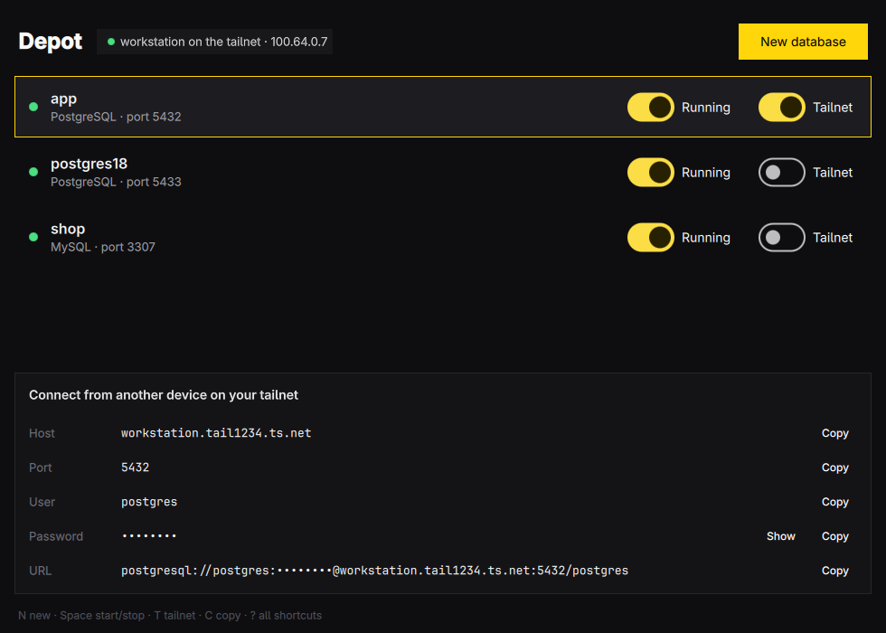

# Depot

Create local databases in Docker and share them with your other devices over
[Tailscale](https://tailscale.com), from one keyboard-driven window built the
way [Omarchy](https://omarchy.org)'s own apps are.



Pick PostgreSQL, MySQL, MariaDB, Redis, MongoDB, or SQL Server, give it a
name, and Depot starts it with a generated password and its data in a Docker
volume. The port listens on `127.0.0.1` only; flip **Tailnet** and Depot runs
`tailscale serve --tcp` so your laptop, and nothing on the local network,
reaches it at `your-machine:5432`. The connection details sit at the bottom of
the window, one click from the clipboard.

Databases made by Omarchy's *Install > Development > Docker DB* show up too,
with a warning before you share one that has no password.

## Install

Depot needs Qt 6, Docker, and Tailscale, all of which Omarchy ships.

```sh
git clone https://github.com/bellinivitor/depot
cd depot
bin/install
```

It then shows up in the app launcher (`Super + Space`).

Two one-time permissions:

- **Docker.** Omarchy keeps Docker behind a password prompt, and Depot needs
  to talk to it directly. Turn on sudoless Docker under *Setup > Security >
  Sudoless Docker* (or `omarchy-setup-security-sudoless-docker`) and reboot.
  Depot offers the button when it can't reach Docker. Note that the docker
  group is root-equivalent.
- **Tailscale.** Let your user change serve settings without sudo:
  `sudo tailscale set --operator=$USER`.

## Shortcuts

| Key | Action |
| --- | --- |
| `N` | New database |
| `↑` `↓` / `J` `K` | Select |
| `Space` | Start or stop |
| `T` | Share on the tailnet, or stop sharing |
| `C` | Copy the connection string |
| `P` | Show or hide the password |
| `Delete` | Remove (asks first, and keeps the data unless you say otherwise) |
| `R` | Refresh |
| `?` | Show shortcuts |
| `Q` | Quit |

## Command line

Everything the window does works without one, for scripts and agents. Each
command exits 0 or 1 with errors on stderr; `list` and `create` take `--json`.

```sh
depot list --json
depot create postgres app            # prints the tailnet connection string
depot create mysql shop --port 3307 --no-expose
depot url app --local
depot start app | depot stop app
depot expose app | depot unexpose app
depot remove app --keep-data
depot skill install                  # teaches Claude Code to drive Depot
```

## Development

```sh
bin/build    # build/depot
bin/test     # Qt Test, offscreen, against fake docker and tailscale CLIs
bin/install  # makepkg -fsi
```

`DEPOT_DOCKER` and `DEPOT_TAILSCALE` point Depot at other binaries, such as
the fakes in `tests/fakes/`.

## License

MIT. The theme and translator code follow
[Omacut](https://github.com/omacom-io/omacut) and
[Monologue](https://github.com/omacom/monologue) by David Heinemeier Hansson.
